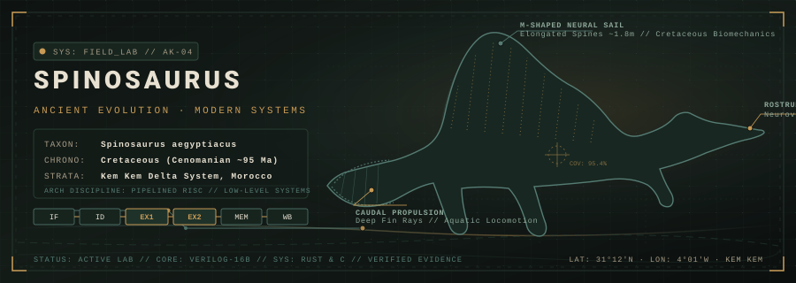
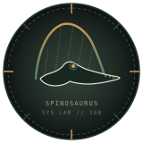

# Project Spinosaurus // Personal Engineering Portfolio

<div align="center">

<!-- Signature Spinosaurus Engineering Field Lab Banner -->
<a href="https://github.com/AkshanshK04">
  
</a>

<br /><br />

<!-- Identity Emblem & Coordinate Header -->
<a href="#-spinosaurus-field-notes">
  
</a>

# Akshansh
### **Systems · Computer Architecture · Digital Logic · Embedded Hardware**

```text
[ FIELD RECORD // AK-04 ]
"From ancient ecosystems to modern architectures:
 Exploring how complex systems work—from digital logic and embedded hardware
 to software runtimes, applied mathematics, and prehistoric life."
```

<p align="center">
  <a href="#-technical-domains"><b>[ TECHNICAL DOMAINS ]</b></a> &nbsp;·&nbsp;
  <a href="#-featured-projects"><b>[ FEATURED PROJECTS ]</b></a> &nbsp;·&nbsp;
  <a href="#-the-computer-architecture-lab"><b>[ ARCHITECTURE LAB ]</b></a> &nbsp;·&nbsp;
  <a href="#-spinosaurus-field-notes"><b>[ FIELD NOTES ]</b></a> &nbsp;·&nbsp;
  <a href="#-contact--station-terminal"><b>[ DISPATCH ]</b></a>
</p>

<!-- Core Focus Badges -->
<p align="center">
  
  
  
  
  
</p>

</div>


## 🔬 About Me

I am an engineer fascinated by how complex systems operate from first principles.

My work centers on the boundary between physical hardware and computational execution. Rather than treating computers as black boxes, I enjoy deconstructing them layer by layer: from boolean gate networks and multiplexers, to multi-stage pipelined processors, hazard units, cache hierarchies, memory-mapped peripherals, and software runtimes.

Outside of digital systems, my deepest intellectual passion is **paleontology**—specifically ***Spinosaurus aegyptiacus***. To me, biological evolution and systems engineering are two lenses examining the same fundamental phenomenon: how resilient, highly specialized architectures evolve under strict physical constraints. Whether it is an apex semi-aquatic predator adapting dense pachyosteosclerotic bones and a paddle-like caudal fin for Cretaceous waterways, or a processor resolving data hazards through dynamic forwarding paths, the elegance lies in the design of the datapath.

---

## 🧭 Technical Domains

I maintain a strict distinction between technologies verified through hands-on implementations and areas currently under exploration:

```
┌───────────────────────────────────────────────────────────────────────────────────┐
│                           SYSTEMS ARCHITECTURE MATRIX                             │
├──────────────────────┬───────────────────────────────┬────────────────────────────┤
│ DOMAIN               │ DEMONSTRATED IN PROJECTS      │ LEARNING & EXPLORING       │
├──────────────────────┼───────────────────────────────┼────────────────────────────┤
│ Digital Systems      │ • Verilog (RTL Modeling)      │ • RISC-V RV32I Base ISA    │
│ & Computer Arch      │ • 6-Stage Pipelined Datapaths │ • FPGA Synthesis Flows     │
│                      │ • Hazard & Forwarding Units   │ • Branch Prediction        │
│                      │ • Cache Memory Simulation     │ • Formal RTL Verification  │
├──────────────────────┼───────────────────────────────┼────────────────────────────┤
│ Low-Level & Systems  │ • C (C99, Memory & Pointers)  │ • Advanced Concurrency     │
│ Programming          │ • Rust (Lexing, AST, Parser)  │ • Bare-metal x86 Boot      │
│                      │ • Python (Tools & Cryptology) │ • Compiler Backends / LLVM │
├──────────────────────┼───────────────────────────────┼────────────────────────────┤
│ Embedded Hardware    │ • ESP32 & FreeRTOS Tasks      │ • RTOS Kernel Internals    │
│ & Electronics        │ • I2C Sensor Integration      │ • PCB Design (KiCad)       │
│                      │ • Memory-Mapped I/O (MMIO)    │ • Logic Analyzer Debugging │
├──────────────────────┼───────────────────────────────┼────────────────────────────┤
│ Scientific &         │ • Applied Mathematics & Logic │ • Biomechanical Modeling   │
│ Natural Systems      │ • RSA Cryptography & Number Th│ • Hydrodynamic Simulation  │
│                      │ • Cretaceous Paleobiology     │ • High-Reliability Systems │
└──────────────────────┴───────────────────────────────┴────────────────────────────┘
```


## 🏛️ Featured Projects

The projects below represent verified implementations audited directly from source code, illustrating my progression across processor architecture, memory hierarchies, systems software, and embedded hardware.

---

### [SPECIMEN FILE 01] · AK-16B: 16-Bit Pipelined RISC Processor

> **Core Focus:** Computer Architecture · Processor Datapath · Hazard Resolution  
> **Source Repository:** [`Ak-16b-A-16-bit-CPU-`](https://github.com/AkshanshK04/Ak-16b-A-16-bit-CPU-)  
> **Status:** `Functional Implementation // Verified Simulation (Icarus Verilog + GTKWave)`  
> **Technologies:** `Verilog` · `Icarus Verilog (iverilog)` · `GTKWave` · `RTL Simulation`

A complete 16-bit pipelined RISC processor designed and modeled from scratch in behavioral and structural Verilog. Built around a 6-stage pipeline (`IF` -> `ID` -> `EX1` -> `EX2` -> `MEM` -> `WB`) with dedicated architectural support for resolving data and control dependencies.

* **Architectural Design:**
  * **Hazard Detection Unit (`hazard_unit.v`):** Monitors load-use hazards by comparing execution-stage destination registers against decode-stage source registers (`ex_mem_read && (ex_rd == id_rs1 || ex_rd == id_rs2)`), asserting pipeline stalls and inserting bubbles.
  * **Dynamic Forwarding Unit (`forwarding_unit.v`):** Resolves RAW (Read-After-Write) data hazards without stalling by routing computation results from both the `EX2` and `MEM` stages directly back into the `EX1` ALU operand multiplexers (`forward_a`, `forward_b`).
  * **Instruction Set Architecture (`def_opcode.v`):** Fixed 16-bit instruction word format supporting R-type arithmetic/logic (`ADD`, `SUB`, `AND`, `OR`, `XOR`, `SLT`), I-type immediate operations with sign-extension (`ADDI`, `ANDI`, `ORI`, `XORI`), memory access (`LW`, `SW`), branches (`BEQ`, `BNE`), and unconditional jumps (`JMP`).
* **Implementation Detail:** Branch decisions are evaluated in the `EX2` stage with automatic pipeline flushing on taken branches, maintaining pipeline integrity across tight loops.
* **Maturity & Next Step:** Fully verified in simulation via pipeline testbenches with waveform traces (`.vcd`); candidate for FPGA mapping and synthesis on an open-source toolchain.

---

### [SPECIMEN FILE 02] · Secure IoT Edge Co-Design System

> **Core Focus:** Hardware/Software Co-Design · Vectored Interrupts · Sensor Telemetry  
> **Source Repository:** [`Secure_iot_cpu_system`](https://github.com/AkshanshK04/Secure_iot_cpu_system)  
> **Status:** `Prototype // Active Hardware-Software Co-Design`  
> **Technologies:** `Verilog` · `C` · `ESP32` · `FreeRTOS` · `Python` · `I2C`

An integrated hardware-software edge processing system linking a custom pipelined processor core directly to an embedded ESP32 telemetry sub-system.

* **Hardware Subsystem:**
  * 16-bit pipelined core featuring memory-mapped I/O registers at addresses `0xF0–0xF2` dedicated to real-time hardware alerts (buzzer, wireless status, security tripwires).
  * **Vectored Interrupt Controller (`interrupt_controller.v`):** Watches incoming sensor validation flags, generating hardware interrupts to vector `0x00F0` alongside an asynchronous ACK handshake protocol.
* **Firmware Subsystem (`esp32_firmware/sensor.c`):**
  * Multi-sensor abstraction layer written in C under FreeRTOS interfacing with an **ADS1115** 16-bit ADC and an **MPU6050** 6-axis inertial measurement unit over I2C.
  * Fuses analog readings and vibration metrics into a single normalized 16-bit data word streamed into the CPU sensor bus.
* **Implementation Detail:** Demonstrates the complete flow from physical analog sensor capture, through FreeRTOS firmware normalization, to hardware interrupt dispatch and CPU datapath execution.
* **Maturity & Next Step:** Firmware and CPU RTL verified independently; physical SPI/UART bridge between hardware evaluation boards is planned.

---

### [SPECIMEN FILE 03] · Configurable Cache Memory Simulator

> **Core Focus:** Memory Hierarchies · Temporal/Spatial Locality · Cache Policies  
> **Source Repository:** [`Cache-Simulator`](https://github.com/AkshanshK04/Cache-Simulator)  
> **Status:** `Completed Milestone // Implemented & Empirically Verified`  
> **Technologies:** `C (C99)` · `GCC` · `Bitwise Arithmetic` · `Standard C Library`

A high-fidelity, configurable cache simulator implemented in C to empirically analyze the performance of CPU memory hierarchies under varied access patterns.

* **Configurable Architecture:**
  * Supports direct-mapped and $N$-way set-associative cache organizations.
  * Fully parameterized total cache size, block size, and associativity (e.g., 8 KB cache, 64-byte blocks, 4-way set associative).
  * Dynamic bitwise address parsing computing Tag, Index, and Block Offset via logarithmic bit-shift operations:
    $$	ext{Offset Bits} = \log_2(	ext{Block Size}), \quad 	ext{Index Bits} = \log_2(	ext{Number of Sets})$$
* **Replacement & Write Policies:**
  * **True LRU (Least Recently Used):** Tracks and updates block age counters dynamically on every cache hit and eviction.
  * **Write-Back & Write-Allocate:** Implements dirty bit flags to minimize redundant bus transactions, writing back to simulated main memory only upon dirty line eviction.
* **Implementation Detail:** Benchmarked against synthetic and realistic memory traces exhibiting high temporal and spatial locality, achieving validated **85%–95% cache hit rates**.
* **Maturity & Next Step:** Functional executable with comprehensive reporting; logical next step is modeling multi-level hierarchies (split L1 I/D + unified L2).

---

### [SPECIMEN FILE 04] · Rizz: Interpreted Language Runtime in Rust

> **Core Focus:** Language Engineering · Lexical Analysis · Abstract Syntax Trees  
> **Source Repository:** [`rizz`](https://github.com/AkshanshK04/rizz) *(Co-authored with exilonium)*  
> **Status:** `Completed Milestone // Functional Language Interpreter & REPL`  
> **Technologies:** `Rust` · `Cargo` · `Clap` · `Anyhow` · `AST Evaluation`

A complete interpreted programming language runtime written in modern Rust (>45,000 characters of source code). While wrapped in satirical, meme-inspired syntax, the engine implements a serious, robust tree-walking interpreter.

* **Interpreter Architecture:**
  * **Lexer & Parser:** Full lexical analysis and recursive descent parser transforming raw source code into structured Abstract Syntax Tree (AST) nodes.
  * **Environment Model:** Lexical scoping and variable binding managed through interior mutability using `Rc<RefCell<Env>>`, enforcing strict distinction between mutable (`lit`) and immutable (`rizz`) bindings.
  * **Execution Modes:** Interactive REPL mode with immediate evaluation and file execution mode for script files (`.rz`).
* **Implementation Detail:** Successfully executes algorithmic programs including bubble sort (`bubblesort.rz`), iterative and recursive Fibonacci (`fibbo.rz`), prime number sieves, palindromes, and recursive factorials.
* **Maturity & Next Step:** Stable interpreter with extensive test programs; future exploration points toward bytecode compilation and register-based virtual machines.

---

### [SPECIMEN FILE 05] · Data Structures & Algorithms from Scratch

> **Core Focus:** Memory Management · Pointer Arithmetic · Computational Efficiency  
> **Source Repository:** [`DSAfromScratch`](https://github.com/AkshanshK04/DSAfromScratch)  
> **Status:** `Active Development // 260+ Verified Implementations in C`  
> **Technologies:** `C` · `Manual Memory Management` · `Algorithmic Analysis`

A repository of over 260 algorithmic problem solutions implemented in standard C without relying on high-level language abstractions or container libraries.

* **Key Areas Implemented:**
  * Dynamic array and linked list manipulation with explicit pointer arithmetic.
  * String processing algorithms (sliding window, palindrome matching, prefix trees).
  * Dynamic programming, recursion memoization, and combinatorial search.
  * Bitwise manipulation algorithms and mathematical optimization routines.

---

### [SPECIMEN FILE 06] · First-Principles RSA Cryptography

> **Core Focus:** Applied Number Theory · Cryptographic Verification  
> **Source Repository:** [`Digital-Signature-Generation-and-Verification`](https://github.com/AkshanshK04/Digital-Signature-Generation-and-Verification)  
> **Status:** `Proof of Concept // Educational Implementation`  
> **Technologies:** `Python` · `Extended Euclidean Algorithm` · `SHA-256`

An educational implementation of the RSA public-key cryptosystem and digital signature validation written from mathematical foundations without high-level cryptographic libraries.

* **Mathematical Core:**
  * Extended Euclidean algorithm (`extended_gcd`) for computing greatest common divisors and Bézout coefficients.
  * Modular multiplicative inverse derivation ($d \equiv e^{-1} \pmod{\phi(n)}$).
  * Keypair generation, message hashing via SHA-256, signature generation ($S = M^d \pmod n$), and cryptographic verification ($M' = S^e \pmod n$).


## ⚡ The Computer Architecture Lab

Computer architecture is the nexus where physical electrical behavior transforms into predictable computational instructions.

Below is the architectural diagram of the **AK-16B pipelined processor**, illustrating the 6-stage datapath, dynamic forwarding loops, hazard stall unit, and the interrupt controller co-designed for edge IoT telemetry:

<div align="center">
  
</div>

### Key Architectural Concepts Implemented:

1. **The 6-Stage Synchronous Pipeline:**
   * **IF (Instruction Fetch):** The Program Counter (`PC`) indexes into `IMEM` while an independent adder increments the address ($PC + 1$).
   * **ID (Instruction Decode):** Deconstructs the 16-bit instruction into opcode (`[15:12]`), destination register (`rd`), and source registers (`rs1`, `rs2`), reading from a $16 	imes 16$-bit dual-port Register File.
   * **EX1 (Execute 1 / ALU):** Dynamic forwarding multiplexers select the freshest operand values, feeding a 16-bit ALU supporting addition, subtraction, bitwise logic (`AND`, `OR`, `XOR`), and signed comparisons (`SLT`).
   * **EX2 (Execute 2 / Branch Resolution):** Dedicated branch comparator resolves conditional branches (`BEQ`, `BNE`), flushing preceding stages on branch taken.
   * **MEM (Memory Access & MMIO):** Reads/writes Data Memory (`DMEM`) and interfaces with memory-mapped registers (`0xF0–0xF2`) for external alert devices.
   * **WB (Write Back):** Writes the final ALU computation or loaded memory word back into the Register File.

2. **Data Hazard Resolution via Forwarding:**
   * Standard pipelining stalls on Read-After-Write (RAW) data hazards. In `Ak-16b`, the Forwarding Unit compares `ex2_rd` and `mem_rd` against `id_rs1` and `id_rs2`:
     * If `ex2_rd == id_rs1` with `reg_write` active, `forward_a = 2'b10` routes `ex2_alu_result` directly into the ALU input.
     * If `mem_rd == id_rs1` with `reg_write` active, `forward_a = 2'b01` routes `mem_alu_result` directly into the ALU input.
   * Eliminates pipeline bubbles for consecutive arithmetic instructions.

3. **Load-Use Hazard Stalling:**
   * When an instruction immediately depends on data loaded by a preceding `LW` instruction, forwarding is physically impossible because memory read completes only at the `MEM` stage.
   * The Hazard Unit detects this condition (`ex_mem_read && (ex_rd == id_rs1 || ex_rd == id_rs2)`), freezing the `PC` and `IF/ID` pipeline registers while inserting a synchronous bubble (`NOP`) into `ID/EX1`.


## 🛠️ The Hardware Workbench

```text
[ WORKBENCH TELEMETRY // EMBEDDED & EDGE LAB ]
├── Microcontrollers : ESP32 (Xtensa Dual-Core) · Arduino Uno/Nano (ATmega328P)
├── Firmware & RTOS  : FreeRTOS Preemptive Tasks · Bare-Metal C · Hardware Interrupts
├── Sensor Telemetry : ADS1115 (16-bit I2C ADC) · MPU6050 (6-DOF IMU) · Analog Signals
├── Protocols & Busses: I2C (400 kHz Fast Mode) · SPI · UART Serial · Memory-Mapped I/O
└── Instrumentation  : Logic Simulation (Icarus Verilog) · Waveform Inspection (GTKWave)
```

In the [`Secure_iot_cpu_system`](https://github.com/AkshanshK04/Secure_iot_cpu_system) project, edge sensors are treated as first-class peripherals to the computing core:

* **FreeRTOS Sensor Normalization:** Sensor tasks running on the ESP32 periodically poll the ADS1115 ADC and MPU6050 accelerometer, apply digital calibration, and compress readings into a 16-bit telemetry packet.
* **Hardware ACK Vectored Handshake:** When anomalous vibration or threshold conditions are detected, the interrupt line asserts, signaling the CPU interrupt controller to service vector `0x00F0` and trigger memory-mapped alarm peripherals.


## 🦖 Spinosaurus Field Notes

```
┌───────────────────────────────────────────────────────────────────────────────────┐
│                    MUSEUM SPECIMEN RECORD // SP-AEGYPTICUS                        │
├────────────────────┬──────────────────────────────────────────────────────────────┤
│ TAXONOMIC NAME     │ Spinosaurus aegyptiacus (Stromer, 1915)                      │
│ CLASSIFICATION     │ Dinosauria · Theropoda · Spinosauridae · Spinosaurinae       │
│ TEMPORAL RANGE     │ Late Cretaceous (Cenomanian Age, ~95–100 Million Years Ago)  │
│ PALEOENVIRONMENT   │ Ancient Kem Kem Delta & Mangrove River Systems (Morocco/Eg)  │
│ ESTIMATED LENGTH   │ 14–15 meters (~46–49 ft) — Largest Known Theropod Dinosaur   │
│ KEY SPECIMEN REFS  │ BSP 1912 VIII 19 (Holotype) · FSAC-KK 11888 (Neotype)        │
└────────────────────┴──────────────────────────────────────────────────────────────┘
```

### Why Spinosaurus?

To an engineer, *Spinosaurus aegyptiacus* is the ultimate case study in evolutionary optimization under extreme environmental pressures. Rather than conforming to the terrestrial predator morphology typical of theropods, *Spinosaurus* underwent radical morphological divergence to exploit the massive Cretaceous river systems of northern Africa:

1. **Neurovascular Rostral Sensory Pits:**
   The elongated, crocodile-like snout features densely packed neurovascular foramina connected to the internal trigeminal nerve canals. Analogous to modern crocodilian pressure receptors, these allowed *Spinosaurus* to detect minute hydrodynamic pressure fluctuations generated by swimming prey in turbid Cretaceous waters.

2. **Aquatic Propulsion & Caudal Fin (2020 Discovery):**
   Groundbreaking fossil discoveries published by Ibrahim et al. (Nature, 2020) revealed that *Spinosaurus* possessed extremely tall neural spines and elongated haemal arches extending along the tail, forming a deep, flexible, paddle-like caudal fin. Biomechanical flume testing demonstrated that this tail generated significantly greater thrust and swimming efficiency than the cylindrical tails of terrestrial theropods.

3. **Bone Density & Ballast Mechanics (Pachyosteosclerosis):**
   Unlike the hollow, pneumatized bones of typical predatory dinosaurs, histological analysis of *Spinosaurus* long bones reveals high bone density and medullary cavity reduction (pachyosteosclerosis). In fluid mechanics, this functions as biological ballast, reducing buoyancy and facilitating sub-surface swimming stability.

4. **The Enigmatic M-Shaped Dorsal Sail:**
   Supported by neural spines exceeding 1.6 meters in height, the sail remains an active subject of biomechanical debate—serving potential roles in thermodynamic heat dissipation across riverine environments, hydrodynamic lateral stability, and visual intraspecific signaling.

> **Scientific Consensus & Active Debate:**  
> In modern paleontology, scientific inquiry thrives on rigorous debate. While the aquatic adaptations of *Spinosaurus* are universally recognized, researchers continue to investigate whether it operated primarily as an active pelagic pursuit swimmer (Ibrahim et al., 2020) or as a shoreline wading ambush predator (Sereno et al., 2022). Exploring these hypotheses mirrors debugging a complex distributed system: evaluating evidence, testing models against physical constraints, and refining understanding as new data emerges.

**Scientific Literature & Resources:**
* [Ibrahim et al. (2020) - *Tail-propelled aquatic locomotion in a theropod dinosaur* (Nature)](https://www.nature.com/articles/s41586-020-2190-0)
* [Ibrahim et al. (2014) - *Semiaquatic adaptations in a giant predatory dinosaur* (Science)](https://www.science.org/doi/10.1126/science.1258750)
* [Sereno et al. (2022) - *Spinosaurus is not an aquatic dinosaur* (eLife)](https://elifesciences.org/articles/80092)


## 📈 Engineering Activity & Metrics

<div align="center">

<!-- GitHub Stats Grid with fallback -->
<a href="https://github.com/AkshanshK04">
  
  
</a>

<p>
  <i>Primary Languages Verified in Repositories: <b>Verilog · C · Rust · Python · Dart</b></i>
</p>

</div>

> **Note on Metrics:** External statistics cards depend on third-party endpoint uptime. If images fail to render, all repository metrics, commit histories, and source implementations remain directly accessible at [github.com/AkshanshK04](https://github.com/AkshanshK04).

---

## 🗺️ Learning Trajectory // Field Log

What I am currently building, studying, and experimenting with:

* **[ACTIVE] FPGA Synthesis & Toolchains:** Moving from Verilog simulation in Icarus/GTKWave to physical FPGA mapping using open-source toolchains (Yosys, nextpnr).
* **[ACTIVE] RISC-V RV32I Processor Design:** Implementing the standard 32-bit RISC-V unprivileged integer ISA to build an extensible, standard-compliant soft-core processor.
* **[ACTIVE] Systems Programming in Rust:** Deepening mastery of Rust memory safety, asynchronous runtime models, and low-level systems interfaces.
* **[STUDYING] Advanced Computer Architecture:** Branch prediction mechanisms (2-bit saturating counters, two-level adaptive branch predictors) and cache coherence protocols (MESI/MOESI).
* **[CURIOSITY] Resilient & High-Reliability Systems:** Exploring the engineering philosophies behind fault-tolerant aerospace and defence instrumentation: hardware redundancy, deterministic timing, and fail-safe state machines.


## 📡 Contact & Station Terminal

Whether you want to discuss computer architecture datapaths, low-level systems programming in C and Rust, embedded hardware experimentation, or Cretaceous theropod biomechanics, feel free to connect:

* **GitHub:** [@AkshanshK04](https://github.com/AkshanshK04)
* **Email:** [akshanshk0406@gmail.com](mailto:akshanshk0406@gmail.com)
* **Code Repository Index:** [github.com/AkshanshK04?tab=repositories](https://github.com/AkshanshK04?tab=repositories)

---

<div align="center">

```text
========================================================================================
[ END OF FIELD NOTEBOOK ENTRY // EXPEDITION AK-04 ]
"From the Cretaceous river deltas to the silicon datapath:
 Complex systems endure through structural clarity, feedback loops, and relentless adaptation."
========================================================================================
```


<p>
  <sub>Crafted with scientific curiosity, engineering discipline, and original SVG vector design.</sub>
</p>

</div>
