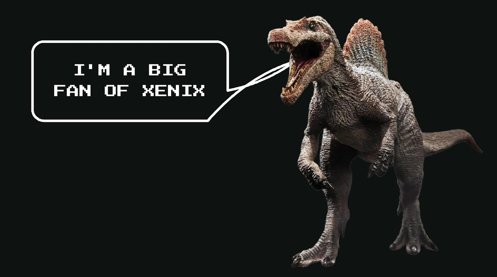
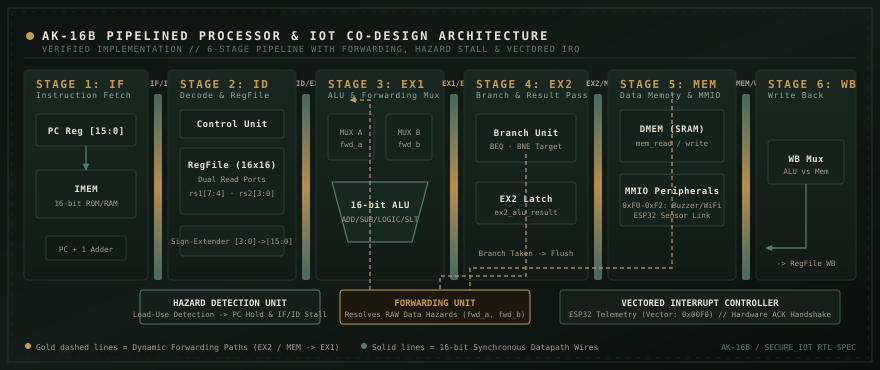

<div align="center">

# Xenix Forever

<p align="center">
  
</p>

### Low-level systems, computer architecture, digital logic, Rust, and C

```text
"Building processors from gate-level logic upward and writing systems software.
 Big fan of Xenix, vintage Unix, pipelined architectures, and Spinosaurus aegyptiacus."
```

<p align="center">
  <a href="https://github.com/AkshanshK04"></a>
  
  
  
</p>

</div>

---

## What I do

I design digital logic in Verilog, write systems software in C and Rust, and develop embedded firmware:

* **Computer architecture.** I design 16-bit pipelined CPU datapaths, forwarding multiplexers, and hazard detection units in Verilog.
* **Systems software.** I write cache simulators and data structures in C, along with tree-walking interpreters and parsers in Rust.
* **Embedded hardware.** I interface ESP32 microcontrollers with real-time sensors over I2C and handle hardware interrupts in FreeRTOS.
* **Paleontology.** I study Spinosaurus aegyptiacus, focusing on its neurovascular cranial structures and semi-aquatic biomechanics.

---

## Featured builds

### [AK-16B: 16-bit pipelined CPU](https://github.com/AkshanshK04/Ak-16b-A-16-bit-CPU-)
> Verilog, Icarus Verilog, GTKWave
* **Pipeline architecture.** Six pipeline stages handle instruction fetch, instruction decode, execute 1, execute 2, memory access, and writeback.
* **Data forwarding.** The forwarding unit routes results from the execute 2 and memory stages directly into execute 1 operands, eliminating read-after-write stalls.
* **Hazard detection.** The hazard unit detects load-use conflicts, halts the program counter, and inserts bubbles until data resolves.
* **Instruction decoder.** The decoder translates R-type arithmetic instructions, sign-extended I-type operations, conditional branches, and jump targets.

<details>
<summary><b>View processor architecture schematic</b></summary>
<br />
<div align="center">
  
</div>
</details>

---

### [Cache simulator](https://github.com/AkshanshK04/Cache-Simulator)
> C99, memory systems
* **Cache topology.** Simulates direct-mapped and N-way set-associative cache configurations.
* **Address mapping.** Splits memory addresses into tag, index, and block offset fields using bitwise shifts.
* **Eviction and writes.** Implements least-recently-used replacement and write-back caching with dirty-bit tracking, reaching 85% to 95% simulated hit rates.

---

### [Rizz: Language runtime and interpreter](https://github.com/AkshanshK04/rizz)
> Rust, AST parser, REPL
* **Tree-walking interpreter.** Interprets programs through an Abstract Syntax Tree walker written in Rust across 45,000 characters of code.
* **Grammar analysis.** Tokenizes input and constructs syntax trees using a hand-written recursive descent parser.
* **Scope resolution.** Resolves variable bindings across nested environments using reference-counted pointers with interior mutability.
* **Language runtime.** Evaluates mutable and immutable variables, conditional branches, loops, and recursive functions.

---

### [Secure IoT edge co-design](https://github.com/AkshanshK04/Secure_iot_cpu_system)
> Verilog, C, ESP32, FreeRTOS
* **Processor interface.** Pairs memory-mapped alert registers from address 0xF0 to 0xF2 with a vectored interrupt line at vector 0x00F0.
* **Sensor pipeline.** ESP32 firmware samples an ADS1115 analog-to-digital converter and an MPU6050 motion sensor over I2C, streaming telemetry frames to the CPU.

---

### [DSA from scratch](https://github.com/AkshanshK04/DSAfromScratch)
> C, 260 solutions
* **Data structures.** Implements linked lists, trees, hash tables, and dynamic arrays in standard C without standard library containers.
* **Algorithms.** Implements pointer arithmetic routines, sliding window techniques, and dynamic programming solutions across 260 standalone files.

---

## Mascot: Spinosaurus aegyptiacus

```text
Kem Kem Beds, Morocco · 95 million years ago
* Neurovascular snout foramina housed pressure sensors that detected aquatic prey.
* Dense bones provided ballast for diving and underwater hunting.
* The 1.8-meter dorsal sail assisted thermoregulation and stability.
* The paddle-like caudal fin generated aquatic propulsion.
```

---

## Activity and terminal

<div align="center">

<a href="https://github.com/AkshanshK04">
  
  
</a>

<br /><br />

```text
>>> CONNECT: akshanshk0406@gmail.com | github.com/AkshanshK04
>>> STATUS : Hacking on custom silicon and low-level runtimes.
```

<sub>Maintained by <b>Xenix Forever</b></sub>

</div>
